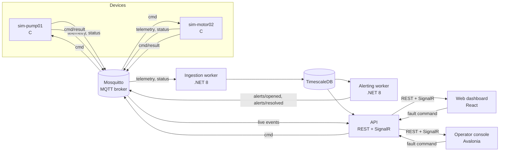

# Live Analytics and Remote Processing(LARP) Monitoring System

A simulated industrial IoT monitoring system, built end to end: C device simulators publish sensor data over
MQTT, a .NET backend stores it in TimescaleDB and evaluates alert rules, and two clients show it live, a React
web dashboard and an Avalonia desktop operator console. Operators can inject faults into the simulated devices
from either client and see the device's own reply.

[](https://github.com/nikolasovanj/LarpMonitoringSystem/actions/workflows/simulator_ci.yml)
[](https://github.com/nikolasovanj/LarpMonitoringSystem/actions/workflows/backend_ci.yml)
[](https://github.com/nikolasovanj/LarpMonitoringSystem/actions/workflows/web_ci.yml)
[](https://github.com/nikolasovanj/LarpMonitoringSystem/actions/workflows/desktop_ci.yml)

It is a portfolio and learning project, so the aim is a realistic, tested pipeline rather than a product.

## Architecture



| Part | Tech | What it does |
|---|---|---|
| `simulators/` | C11, libmosquitto, cJSON | Simulated devices. Each one publishes several sensors with drift and noise, supports injected faults, and reports status with an MQTT Last Will. |
| `infrastructure/` | Mosquitto, TimescaleDB | Broker config and the database schema (`init.sql`). |
| `backend/` | .NET 8 | `Ingestion` (MQTT to database), `Alerting` (rule evaluation), `Api` (REST and SignalR), plus shared `Core` and `Contracts` projects. |
| `web/` | React 18, TypeScript, Vite | Live dashboard: devices, charts, alerts, fault injection. |
| `desktop/` | Avalonia 11, .NET 8 | Desktop operator console with the same features. |

## Quick start

You need Docker with Compose.

```bash
docker compose up -d --build
```

This starts the broker, two simulated devices (`pump01`, `motor02`), TimescaleDB, the ingestion, alerting and API
services, and the web dashboard.

| What | Where |
|---|---|
| Web dashboard | http://localhost:5173 |
| API | http://localhost:8080 (for example `/api/devices`) |
| MQTT broker | `localhost:1883` |
| TimescaleDB | `localhost:5432` (database `iot`, user `iot`) |

Watch the raw MQTT traffic:

```bash
mosquitto_sub -h localhost -t 'factory/#' -v          # with mosquitto-clients installed
docker compose --profile debug up monitor             # or from a container
```

Set `DB_PASSWORD` in the environment or a `.env` file to replace the development default.

### Desktop operator console

```bash
cd desktop/Monitor.Operator
dotnet run                     # talks to http://localhost:8080
```

Or in a container on Linux (X11 or XWayland): `xhost +local:docker` and then
`docker compose --profile desktop up --build operator`. More in
[`desktop/Monitor.Operator/README.md`](desktop/Monitor.Operator/README.md).

## MQTT topics

All topics live under `factory/{site}/{line}/{device}/`.

| Topic | Direction | Payload |
|---|---|---|
| `.../status` | device to broker | `online` / `offline`; retained, `offline` is the Last Will |
| `.../{sensor}/telemetry` | device to broker | JSON reading with value, unit and a millisecond timestamp |
| `.../cmd` | operator to device | JSON command, for example inject a fault |
| `.../cmd/result` | device to broker | JSON result: accepted, or rejected with an error |
| `alerts/opened`, `alerts/resolved` | alerting to broker | JSON alert event |

Device IDs are used as MQTT client IDs, so two simulators must never share one.

## Simulators

Each simulator is configured by environment variables:

| Variable | Default | Meaning |
|---|---|---|
| `DEVICE_ID` | required | Device name; letters, digits, `-` and `_` only |
| `SITE` / `LINE` | `site1` / `line1` | Where the device sits in the topic tree |
| `BROKER_HOST` / `BROKER_PORT` | `localhost` / `1883` | MQTT broker |
| `PUBLISH_INTERVAL_MS` | `1000` | Time between readings, 10 to 3600000 |
| `SENSORS` | `temperature,vibration,pressure` | Which sensors the device has |
| `FAULT_PROBABILITY` | `0` | Chance of a random fault per reading, 0 to 1 |
| `SEED` | `0` | Random seed, for repeatable runs |

Sensor profiles: `temperature` (°C), `vibration` (mm/s), `pressure` (bar), `flow` (L/min), `current` (A),
`ultrasonic` (mm). Faults: `spike`, `stuck`, `dropout`, `ramp`, `noisy`.

Add a device by copying a `sim-*` service in `docker-compose.yml` and giving it a new `DEVICE_ID`.

## API

REST, JSON, camelCase:

| Endpoint | Purpose |
|---|---|
| `GET /api/devices` | Devices with status and latest value per sensor |
| `GET /api/alerts?openOnly=true` | Alerts |
| `POST /api/alerts/{id}/ack` | Acknowledge an alert, body `{ "by": "name" }` |
| `GET /api/series/{id}/history?from&to&maxPoints` | History, read from raw data or the 1-minute rollup |
| `POST /api/devices/{site}/{line}/{device}/faults` | Inject a fault, body `{ "sensor", "fault", "duration" }`. Returns 202 once the command is published |

SignalR hub `/hubs/live` pushes `Telemetry`, `DeviceStatus`, `CommandResult` and `Alert` events. A 202 from the
fault endpoint only means the command was published; the device's answer arrives as a `CommandResult` event.

## Data and alerts

- Readings go into a TimescaleDB hypertable with compression and retention policies and a continuous aggregate
  (`telemetry_1m`) for long ranges.
- Ingestion batches inserts and de-duplicates on `(series_id, time)`, so redelivered MQTT messages are harmless.
- The alerting worker evaluates rules stored in the database, opens and resolves alerts, and publishes
  `alerts/opened` and `alerts/resolved`. Rules are managed in the database for now; there is no rule API yet.

## Development

### Simulators

Needs a C compiler, CMake, `libmosquitto-dev` and `libcjson-dev`.

```bash
cmake -S simulators -B simulators/build
cmake --build simulators/build
ctest --test-dir simulators/build --output-on-failure     # unit tests: config, sensor, cmd
simulators/tests/integration.sh                           # against a running broker
```

### Backend

Needs the .NET 8 SDK. The integration tests use Testcontainers, so Docker must be running.

```bash
dotnet test backend
```

### Web

Needs Node 22.

```bash
cd web
npm install
npm run dev            # http://localhost:5173, proxies /api and /hubs
npm test               # unit tests
npm run e2e:install    # once
npm run e2e            # Playwright against a mock backend, no Docker needed
npm run e2e:stack      # Playwright against the real compose stack
```

The dev server proxies to `http://127.0.0.1:5080` by default. To use the compose API, put
`VITE_PROXY_TARGET=http://127.0.0.1:8080` in `web/.env.local`, and stop the `web` container first since both use
port 5173.

### Desktop

```bash
dotnet test desktop/Monitor.Operator.Tests
```

## Tests and CI

| Area | What is tested | Workflow |
|---|---|---|
| Simulators | Config parsing, sensor behaviour, command handling, an end-to-end script against a broker | `simulator_ci.yml` |
| Backend | Ingestion, device lifecycle, API and alerting against real TimescaleDB and Mosquitto containers | `backend_ci.yml` |
| Web | Live store unit tests, Playwright browser tests | `web_ci.yml` |
| Desktop | View-model unit tests on fakes, no display needed | `desktop_ci.yml` |

## Repository layout

```
simulators/       C simulators, CMake, unit and integration tests, Dockerfile
backend/          .NET solution: Core, Contracts, Ingestion, Api, Alerting, tests
infrastructure/   mosquitto/mosquitto.conf, timescaledb/init.sql
web/              React dashboard, Playwright tests, Dockerfile, nginx.conf
desktop/          Avalonia operator console, tests, Dockerfile
docker-compose.yml
.github/workflows/
```

## Roadmap

- Authentication on the API and hub
- An API to manage alert rules
- More device types and sensor profiles
